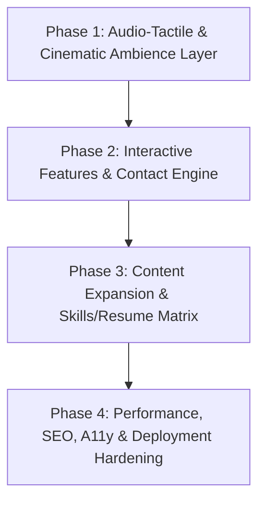

# Project Roadmap

Project: **Sushmita — The Series**  
Milestone: **1.0 (Cinematic Portfolio Platform Revamp & Expansion)**  
Mode: **Balanced (Tracer-First, Verified Phased Execution)**

---

## Phase Overview

---

## Phase 1: Audio-Tactile & Cinematic Ambience Layer

**Goal:** Establish an immersive sensory layer with audio cues, ambient lighting bloom, tactile feedback, and responsive layout refinement.

- [x] **Task 1.1 (Tracer Slice):** Build a Web Audio API synthesizer hook (`useSoundFX`) with synthesized Netflix-style intro sting, subtle UI clicks, volume attenuation, and a persistent mute toggle in `Navbar`.
- [x] **Task 1.2:** Implement ambient card lighting and cursor-tracked radial glow effects (`ambientGlow`) with GPU-accelerated CSS properties.
- [x] **Task 1.3:** Refine mobile responsive behaviors: bottom-sheet drawer patterns for mobile modal viewports and touch rail velocity tuning.
- [x] **Task 1.4:** Enforce accessibility safeguards: complete bypass of audio and heavy canvas shaders when `prefers-reduced-motion` is active.

**Verification Criteria:**
- Sound engine initializes only on user interaction (browser autoplay policy compliant).
- Navbar sound toggle reflects mute state, persists across refreshes, and offers keyboard access.
- Frame rate remains stable at 60 FPS across desktop and mobile devices.
- `prefers-reduced-motion` cleanly disables audio and heavy effects.

---

## Phase 2: Interactive Features & Contact Engine

**Goal:** Provide visitor engagement tools: a functional contact modal, 3D card physics, animated metric counters, and rich project showcase links.

- [x] **Task 2.1 (Tracer Slice):** Implement a fully validated `ContactModal` with reactive field validation (name, email, subject, message), loading spinner, and flexible email handler (Formspree/EmailJS ready).
- [x] **Task 2.2:** Add 3D perspective tilt physics (`TiltCard`) with subtle specular highlight glares for project posters and featured cards.
- [x] **Task 2.3:** Implement smooth viewport-triggered animated metric counters (`AnimatedCounter`) for project stats and achievements.
- [x] **Task 2.4:** Upgrade `ProjectModal` to support tabbed deep dives: Architecture Overview, Key Challenges & Metrics, and live Demo/Code buttons.

**Verification Criteria:**
- Contact form validates email format and required fields, handles submission states gracefully, and traps focus properly.
- 3D tilt feels smooth and natural with zero jitter or performance degradation.
- Numbers count up smoothly when scrolled into view.
- Overlays open and close via Esc and backdrop click without leaving orphaned scroll locks.

---

## Phase 3: Content Expansion, Skills Matrix & Resume Optimization

**Goal:** Maximize recruiter and engineer impact by enriching case studies, adding an interactive skills explorer, and polishing the resume viewer.

- [ ] **Task 3.1 (Tracer Slice):** Update `src/data/portfolio.ts` with comprehensive project deep-dives, updated metrics, and detailed architecture notes.
- [ ] **Task 3.2:** Upgrade `Skills.tsx` into an Interactive Skills Explorer with category filters (AI/ML, Full-Stack, Java/Backend, Cloud/DevOps) highlighting related project evidence.
- [ ] **Task 3.3:** Polish `ResumeViewer.tsx` and `ResumeModal.tsx` with high-fidelity styled view, print-friendly CSS media rules (`@media print`), and clear PDF download triggers.
- [ ] **Task 3.4:** Add dynamic recommendation tags based on selected profile (Recruiter vs. Developer vs. AI Researcher).

**Verification Criteria:**
- `portfolio.ts` adheres to strict TypeScript types with no compiler warnings.
- Skills filtering is instant and highlights accurate evidence cards.
- Resume print preview renders clean, professional, and page-break optimized.

---

## Phase 4: Performance, SEO, A11y & Deployment Hardening

**Goal:** Ensure enterprise-grade polish, top Lighthouse scores, discoverability, accessibility, and production deployment pipeline.

- [ ] **Task 4.1 (Tracer Slice):** Comprehensive SEO setup in `index.html` (Open Graph meta, Twitter card tags, favicon set, canonical URL, and JSON-LD schema for Person & CreativeWork).
- [ ] **Task 4.2:** Accessibility audit and keyboard navigation pass (visible focus rings, aria-modal, aria-label on icon buttons, skip link to main content).
- [ ] **Task 4.3:** Asset and bundle optimization (font preloading, code-split dynamic imports, image responsive srcSets verification).
- [ ] **Task 4.4:** Production build verification (`npm run build`, `npm run preview`), zero lint or type errors, and deployment documentation for Vercel/Netlify.

**Verification Criteria:**
- `npm run build` succeeds cleanly with no TypeScript errors.
- Lighthouse scores >= 90 across all categories.
- Screen readers and keyboard navigation can access every modal and section.
- Social sharing preview tags display correctly.
